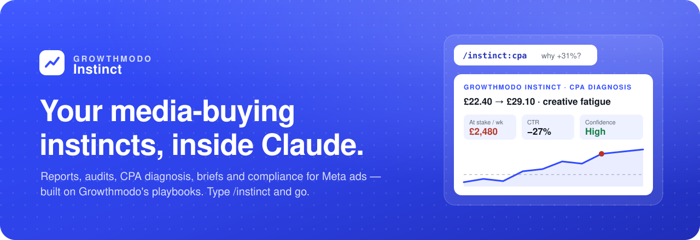
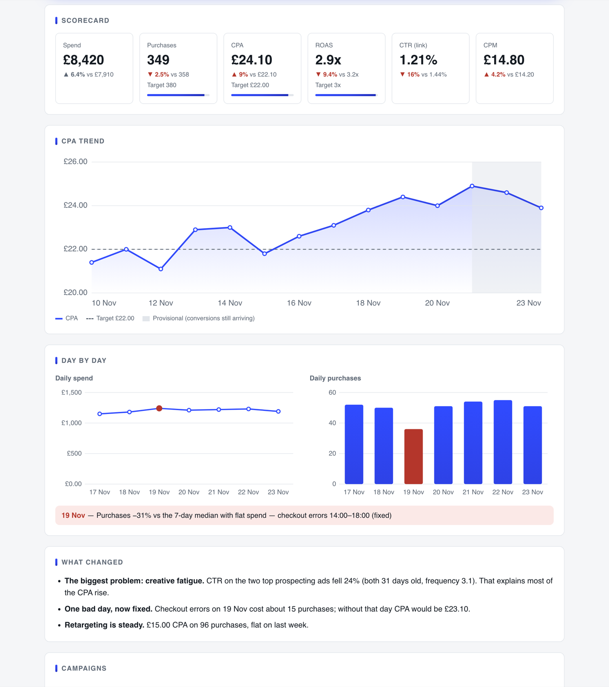
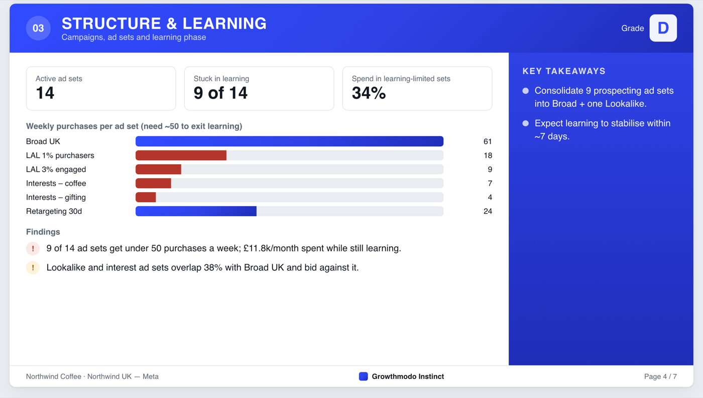

<p align="center">
  
</p>

<p align="center">
  
  
  
  
</p>

<h3 align="center">Stop asking Claude for "some ideas".<br>Ask it the way a senior media buyer would — and get the answer a senior media buyer would give.</h3>

<br>

Growthmodo Instinct plugs **Growthmodo's media-buying playbooks** into Claude. Type `/instinct`, pick a job, and Claude works the way our buyers do: it checks the numbers before it believes them, finds *where* the money went, says how sure it is, and hands you **one** thing to do. Reports and audits come back as **branded, client-ready pages** — not a wall of chat.

<br>

## ⚡ Install in 60 seconds

In Claude Code (terminal, the desktop app's Code tab, or your IDE):

```text
/plugin marketplace add growthmodo-access/instinct-plugin
```

```text
/plugin install instinct@growthmodo
```

Paste the **license key** from your Growthmodo welcome email when asked (it starts with `gmi_`). It goes into your system's secure storage and is only ever sent to Growthmodo Instinct. Restart Claude Code, type `/instinct`, done.

> [!TIP]
> Connect a **Meta Ads** MCP server too, so audits, diagnoses and reports read your live numbers. Without it, Claude simply asks you for an export.

<br>

## 🧠 Ten commands. All of Meta media buying.

From the first brand conversation to the monthly report, the same ten commands work for a brand spending $2,000 a month and one spending $20 million. The rules scale with the spend.

| | Command | What you get back |
|:-:|---|---|
| 🚀 | `/instinct:start` | **Brand onboarding**: what's connected, the brand profile, the Mandate (targets, limits, who approves) and a tracking check |
| 🔭 | `/instinct:research [competitors]` | **Market research**: competitor ads plus what customers actually say, turned into angles you can own |
| 🎯 | `/instinct:angles <offer>` | **Creative strategy**: angles, hooks and concepts, each with a hypothesis and test plan, plus a designer-ready brief |
| 🎬 | `/instinct:creative <concept>` | **Ad creative**: copy variants, ready-to-paste image ad prompts, and video ads made with your AI video tool after you approve the storyboard and the credits |
| 🛡️ | `/instinct:check <ad / url>` | **Pre-launch check**: Meta policy and local rules, the landing page (graded, with rewrites) and tracking, each pass, fix or block |
| 🛫 | `/instinct:launch <offer>` | **Plan & launch**: a media plan sized to the budget, built **paused**, live only when you say so, with a launch tracker |
| 📈 | `/instinct:monitor` | **Pacing & monitoring**: spend vs plan per market, delivery problems, tracking outages, Day 1/3/7/14 checkpoints |
| 📉 | `/instinct:optimize [question]` | **Performance optimizer**: why CPA moved, what to scale, hold, fix or cut, or a graded audit deck |
| 📊 | `/instinct:report <client>` | A **branded client report**: scorecard vs target, day-by-day charts, a verdict on every campaign |
| 🧠 | `/instinct:learnings` | **Learnings log**: close out tests and keep what won and lost, so the next round starts smarter |
| 🆕 | `/instinct:whats-new` | What changed in the playbooks since you last looked |

Prefer plain English? Just ask — *"why did CPA jump on Prospecting UK this week?"* — Instinct picks the right playbook on its own.

<br>

## 🖼️ What lands on your screen

<table>
  <tr>
    <td width="50%" valign="top">
      
      <p align="center"><b>Client report</b><br><sub>Anomaly days in red, explained. A verdict on every campaign.</sub></p>
    </td>
    <td width="50%" valign="top">
      
      <p align="center"><b>Audit deck — cover</b><br><sub>Overall grade and the money at stake, before anything else.</sub></p>
      <br>
      
      <p align="center"><b>Audit deck — area slide</b><br><sub>Grade, the chart that shows the problem, and what to do about it.</sub></p>
    </td>
  </tr>
</table>

<p align="center"><sub>Sample data. Live previews: <a href="https://instinct.growthmodo.com/samples/report">client report</a> · <a href="https://instinct.growthmodo.com/samples/audit">audit deck</a></sub></p>

<br>

## 🔁 How it works

<p align="center">
  
</p>

The playbooks live on Growthmodo's servers and are sent to Claude only when you're licensed — so every improvement we make reaches you on your **next message**, with nothing to update.

<br>

## 💬 It sounds like this

> **You:** `/instinct:optimize CPA on Prospecting UK went from £22 to £29 this week`
>
> **Growthmodo Instinct** · Performance Optimizer
>
> **Money at stake:** ~£2,480 a week at the new CPA.
> **What happened:** CPA £22.40 → £29.10 (+30%) on 412 → 371 purchases. Not noise.
> **Where:** "Prospecting – Broad UK" explains 78% of the extra cost; retargeting is flat.
> **Why (high confidence):** CTR fell 27% on the top two ads — both 31 days old, frequency 3.1 — while CPM (+4%) and conversion rate (−2%) held. Creative fatigue. Checkout and auction ruled out.
> **Do this:** launch two replacement ads into the same ad set this week; keep budget unchanged. Success = CPA under £24 within 7 days.
>
> *Growthmodo Instinct · built on Growthmodo's media-buying playbooks*

<br>

## 🧭 The rules every answer follows

<table>
  <tr>
    <td>🔢 <b>Numbers, not adjectives</b><br><sub>"CPA +18% (£22.10 → £26.08)", never "CPA rose significantly".</sub></td>
    <td>☝️ <b>One recommendation</b><br><sub>The action we'd take — not a menu of ten.</sub></td>
    <td>🎚️ <b>Says how sure it is</b><br><sub>High / medium / low confidence, and what would change its mind.</sub></td>
  </tr>
  <tr>
    <td>🚫 <b>No invented data</b><br><sub>Missing number? It asks. It never fills gaps with "typical" figures.</sub></td>
    <td>🔒 <b>Read-only by default</b><br><sub>It never touches budgets, bids or ads unless you ask and confirm.</sub></td>
    <td>⏳ <b>Respects conversion lag</b><br><sub>Recent days are provisional; small samples are called noise.</sub></td>
  </tr>
</table>

<br>

## ❓ Questions

<details>
<summary><b>Can it change my ads or budgets?</b></summary>
<br>
No. Every playbook is read-only. Claude will list a change and only make it if you explicitly ask and confirm that specific change — and only if your Meta connector allows writes at all.
</details>

<details>
<summary><b>Where does my license key go?</b></summary>
<br>
Into your operating system's secure storage via Claude Code's plugin settings. It's sent only to <code>mcp.growthmodo.com</code>, the Growthmodo Instinct server. Change it any time: <code>/plugin</code> → <b>instinct</b> → <b>Configure</b>.
</details>

<details>
<summary><b>I use claude.ai, not Claude Code.</b></summary>
<br>
Same playbooks, no plugin needed: add Instinct as a custom connector with the URL from your welcome email, then use the <b>+</b> menu starters. Full guide: <a href="https://instinct.growthmodo.com/">instinct.growthmodo.com</a>.
</details>

<details>
<summary><b>How do I get updates?</b></summary>
<br>
Playbook updates are automatic — they're served live. For new commands, run <code>/plugin</code> → <b>instinct</b> → <b>Update</b>. Ask <code>/instinct:whats-new</code> to see what changed.
</details>

<details>
<summary><b>Commands say the Instinct tools are missing.</b></summary>
<br>
The license key isn't set or isn't active. Run <code>/plugin</code> → <b>instinct</b> → <b>Configure</b> and paste the key from your welcome email, then restart Claude Code. Still stuck? Contact Growthmodo.
</details>

<br>

## 📦 What's in this repo

Only the plugin wiring: the slash commands and the secure connection to Growthmodo Instinct. The playbooks, thresholds and templates are served by Instinct to licensed users and are not part of this repository.

## License

Proprietary — see [LICENSE](LICENSE). Licensed Growthmodo Instinct customers may install and use this plugin; copying, modifying or redistributing it is not permitted.

<p align="center"><br><sub>Made by <b>Growthmodo</b> · <a href="https://instinct.growthmodo.com/">instinct.growthmodo.com</a></sub></p>
